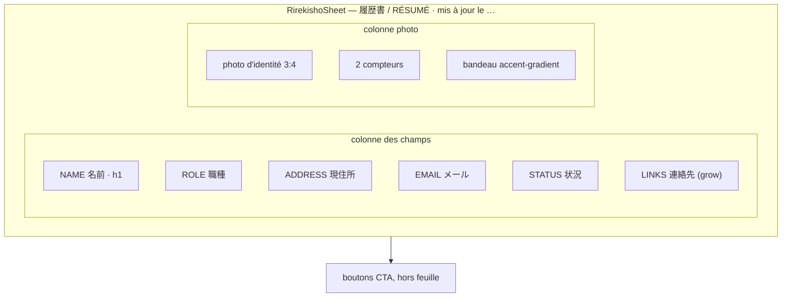
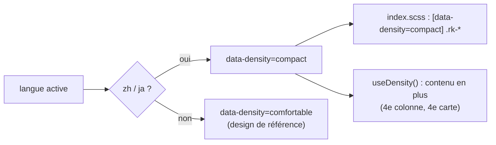

# Design System — sachadvr.fr

Référence unique pour toute nouvelle UI du site. Tout écran ajouté doit s'y conformer.

## 1. Philosophie

**Neo-brutalism « éditorial », calqué sur la grammaire visuelle de blacksmith.sh.**

Trois principes, dans cet ordre de priorité :

1. **Franchise** — bordure **1px encre** (`#202020`) sur tous les blocs, ombre dure **sans flou,
   offset pur, toujours en encre** (`8px 8px #202020` / `4px 4px #202020`). Un élément est soit
   posé sur la page, soit clairement détaché ; pas d'entre-deux. Jamais d'ombre colorée.
2. **Terminal** — libellés en capitales monospace, prompts `$`, curseur clignotant, fenêtres
   « finder » à en-tête jaune. C'est le vocabulaire du métier de Sacha.
3. **Respiration** — le brutalisme fournit le contraste, pas le bruit. Fond gris très clair,
   cartes blanches, un seul accent jaune, sections espacées (`py-20`). Une carte a une bordure
   **ou** un fond coloré, pas trois décorations.

Ce qu'on ne fait **pas** : ombres floues ou colorées, bordures épaisses (2–3px), rotations façon
sticker, polices pixel, pastilles rouge/jaune/vert façon macOS, emojis décoratifs.

## 2. Palette

Palette **exacte** reprise de la référence — trois couleurs, rien d'autre.

| Token         | Hex       | Rôle                                                                 |
| ------------- | --------- | -------------------------------------------------------------------- |
| `ink`         | `#202020` | **texte, bordures et ombres** — quasi-noir, jamais `#000` pur         |
| `paper`       | `#f5f5f5` | fond de page (`background`, `secondary`, `muted`)                     |
| `card`        | `#FFFFFF` | fond des surfaces / fenêtres                                          |
| `yellow`      | `#f0fb29` | **accent signature** (chartreuse, pas un lime) — en-têtes de fenêtre, surlignage, badges, texte des CTA |
| `sky`         | `#aee3fd` | bleu pastel — uniquement en départ de dégradé                         |
| `destructive` | `#F4543C` | erreurs, `stderr`                                                     |

Dégradé unique de la charte (barres de comparaison, bandeaux de statut, légendes) :

```
bg-accent-gradient   linear-gradient(90deg, #aee3fd, #f0fb29)
```

**CTA principal** = fond encre + texte jaune (`Button variant="default"`), à l'inverse du
surlignage qui est fond jaune + texte encre. `ink` sert **à la fois** de bordure et d'ombre :
c'est ce qui donne la cohérence brutaliste. On ne borde jamais en gris.

### Dark mode

Inversion sobre (classe `.dark` sur `<html>`, pas encore de toggle UI) : fond `#202020`, surfaces
`#2b2b2b`, bordures et ombres en `#f5f5f5`. Le jaune reste identique — il fonctionne sur les deux
fonds.

### Accent par langue

L'encre, les ombres, les rayons et le reste de la palette sont **identiques dans les cinq
langues**. Seule la teinte d'accent (`--accent`/`--accent-foreground`) varie légèrement, posée via
`data-lang-accent` sur `<html>` (cf. `applyDensity` dans `src/i18n/config.ts`, surcharges dans
`src/index.scss`) :

| Langue | `--accent` | Justification |
|---|---|---|
| en | `63 96% 57%` (jaune signature, inchangé) | Référence du design system, code visuel tech/SaaS anglophone |
| fr | `210 22% 60%` (bleu-gris sobre) | Le marché français valorise la retenue en design — moins de saturation que le jaune vif |
| es | `14 78% 62%` (corail chaud) | Le marché hispanophone tolère davantage de chaleur/saturation dans le digital (retail, banque) |
| zh | `200 50% 70%` (bleu-vert clair) | Teinte sobre, volontairement **pas** de rouge/or |
| ja | `20 60% 68%` (rose poudré clair) | Teinte discrète, **pas** de rouge (drapeau) |

Explicitement écarté : associer une couleur "culturelle" cliché (rouge/or pour la Chine, bleu-blanc-rouge
pour la France…) — chaque teinte reste dans un registre sobre, différenciée par un vrai raisonnement
UX (usages perçus du marché) plutôt qu'un symbole national. Ce qui varie plus nettement selon la
langue, c'est la **densité d'information** — voir § 8.

### Où sont définies les couleurs

Variables CSS HSL dans `src/index.scss` (`:root` et `.dark`), exposées à Tailwind dans
`tailwind.config.js` via `hsl(var(--token))`. **Ne jamais écrire un hex en dur dans un composant** —
utiliser `bg-primary`, `text-muted-foreground`, `border-border`, etc.

## 3. Typographie

| Famille        | Police         | Usage                                                      |
| -------------- | -------------- | ---------------------------------------------------------- |
| `font-sans`    | IBM Plex Sans  | **défaut sur `body`** — corps de texte                      |
| `font-display` | IBM Plex Sans  | `h1`–`h4` (appliqué automatiquement), chiffres clés          |
| `font-mono`    | IBM Plex Mono  | **tous** les labels, capitales, valeurs techniques, code     |

Auto-hébergées (`public/fonts/`, `@font-face` dans `src/fonts.css` importé par `src/index.scss`),
avec repli système. Seuls les sous-ensembles `latin` et `latin-ext` sont embarqués : le chinois et
le japonais retombent sur les polices système. Pour régénérer après un changement de graisse,
repartir de l'URL Google Fonts citée en tête de `src/fonts.css`.

Règles :

- **Titres** : `font-semibold`, interligne serré et **tracking négatif marqué** — appliqué en base :
  `h1`/`h2` → `letter-spacing: -0.0625em` (= -6px à 96px, -4px à 64px, l'échelle de la ref),
  `h3`/`h4` → `-0.03em`.
- **Labels mono** (badges, en-têtes de fenêtre, labels de formulaire, footer, boutons) :
  `font-mono text-xs font-medium uppercase tracking-[0.5px]`. Le `0.5px` est la valeur exacte de la
  ref — on n'utilise plus `tracking-[0.15em]`.
- **Corps de texte** : `text-sm leading-relaxed text-muted-foreground`. On réserve le `foreground`
  plein aux éléments à mettre en avant (`<strong className="text-foreground">`).
- **Surlignage** : classe `.highlight` — fond jaune plein + `font-semibold`, coins nets.
  Maximum un ou deux par bloc.
- **Étiquettes techniques** : classe `.tech-label` (`text-[10px]` mono, capitales, `0.5px`).

## 4. Règles de forme

**Radius par contexte** — c'est binaire : **0 sur tout ce qui est bloc, pill complet sur tout ce
qui est interactif arrondi.**

| Token            | Valeur   | Où                                                                  |
| ---------------- | -------- | ------------------------------------------------------------------- |
| `rounded-window` | `0px`    | fenêtres et cartes (`.window-box`, `TerminalWindow`, `Card`)         |
| `rounded-soft`   | `0px`    | inputs, `.brutal-box`, `.tech-label`, vignettes                      |
| `rounded-pill`   | `100px`  | **boutons CTA**, badges, `.section-label`, `.sticker`, pastilles      |
| `--radius`       | `0px`    | valeur shadcn par défaut                                             |

| Propriété    | Valeur                          | Remarque                                   |
| ------------ | ------------------------------- | ------------------------------------------ |
| **Bordures** | `1px solid` `hsl(var(--border))` | **partout** — plus aucun `border-2`/`border-3` |
| **Ombres**   | offset dur, encre, sans flou     | voir ci-dessous                             |

Ombres (`tailwind.config.js`) — format exact `NNpx NNpx <encre>`, **pas de blur, pas de spread,
pas d'autre couleur** :

```
shadow-brutal-sm   4px 4px ink   ← petits éléments : boutons, badges, inputs, .brutal-box
shadow-brutal      8px 8px ink   ← la signature : fenêtres, grands blocs
shadow-brutal-lg  12px 12px ink  ← état hover des cartes
```

**Interactions** :

- **Boutons** : `hover:scale-[1.025]` (valeur de la ref), aucun déplacement d'ombre.
- **Cartes cliquables** (`.brutal-interactive`) : déplacement `-3px, -3px` + ombre `lg` au survol,
  retour à `0,0` + `sm` au clic. Transition `100ms`.

**Focus** : `ring-2 ring-ring ring-offset-2` sur tous les éléments focusables, en encre.

## 5. Classes utilitaires maison

Définies dans `src/index.scss` :

| Classe                 | Effet                                                                 |
| ---------------------- | --------------------------------------------------------------------- |
| `.brutal-box`          | bordure 1px + coins nets + fond `card` + `shadow-brutal-sm`            |
| `.window-box`          | la **fenêtre** (finder-window) : coins nets, bordure 1px, `overflow-hidden`, `shadow-brutal` (8px) |
| `.window-chrome`       | en-tête de fenêtre : fond **jaune** plein, texte encre, bordure basse 1px |
| `.window-chrome-dot`   | traffic-light : rond **encre plein de 8px** (3 par fenêtre) — pas de rouge/jaune/vert |
| `.brutal-interactive`  | l'animation hover/active décrite plus haut                             |
| `.dotted-box`          | carte **en pointillés** : bordure 1px `dotted` + coins nets + fond `card`, sans ombre |
| `.dotted-interactive`  | variante d'interaction des cartes pointillées : au survol le pointillé se **solidifie**, la carte décolle et prend `shadow-brutal` |
| `.sticker`             | pastille `rounded-pill` bordée 1px + `shadow-brutal-sm`                |
| `.tech-label`          | puce techno mono capitales espacées                                    |
| `.highlight`           | surlignage jaune plein, coins nets                                     |
| `.terminal-prompt`     | préfixe `$ ` en jaune avant le contenu                                 |
| `.section-label`       | étiquette encre/jaune `rounded-pill` au-dessus des titres de section   |
| `.bg-grid`             | quadrillage 32px très discret (fonds de page : hero, 404, links)       |
| `.bg-scanlines`        | lignes horizontales façon CRT (disponible, non utilisé par défaut)     |
| `.dot-grid`            | grille de points 20px                                                  |
| `.dot-pattern-strip`   | motif de points dense 5px sur fond clair (bandeaux)                    |

## 6. shadcn/ui

Installé « à la shadcn » : les composants sont **vendorisés** dans `src/components/ui/` et modifiés
directement — pas de surcharge par-dessus une librairie.

- Config : `components.json` (style `new-york`, alias `@/*`, CSS vars activées).
- Alias `@` → `src/` déclaré dans `vite.config.ts` **et** `tsconfig.json`.
- Utilitaire `cn()` dans `src/lib/utils.ts` (clsx + tailwind-merge).
- Ajouter un composant : `npx shadcn@latest add <nom>` puis **le rebrutaliser** — remplacer les
  `rounded-*` par `rounded-pill` (interactif) ou rien (bloc, coins nets), remplacer `shadow-*` par
  `shadow-brutal*`, passer les bordures en `border` (1px), mettre les labels en
  `font-mono uppercase tracking-[0.5px]`.

### Primitives disponibles

| Composant   | Variantes / notes                                                                    |
| ----------- | ------------------------------------------------------------------------------------ |
| `Button`    | `default` (**fond encre / texte jaune**), `accent` (fond jaune / texte encre), `outline` (blanc), `destructive`, `ghost`, `link` — tailles `sm`/`default`/`lg`/`icon`. `rounded-pill`, `shadow-brutal-sm`, hover `scale-[1.025]`, label mono capitales. |
| `Card`      | alias de `.window-box` + `CardHeader/Title/Description/Content/Footer`                 |
| `Input`     | h-11, coins nets, bordure 1px, `shadow-brutal-sm` → `shadow-brutal` au focus            |
| `Textarea`  | idem, min-h 120px                                                                      |
| `Label`     | micro-label en capitales espacées                                                      |
| `Badge`     | pastille `rounded-pill` — `default` / `accent` (jaune plein) / `outline` / `muted`      |
| `Separator` | trait plein 1px                                                                        |

### Composants métier

| Composant         | Rôle                                                                            |
| ----------------- | ------------------------------------------------------------------------------- |
| `TerminalWindow`  | **le conteneur des pages secondaires** (repo, 404, liens) : `.window-box` + en-tête jaune, trois traffic-lights encre de 8px et titre mono capitales (`stderr`, `~/metadata`, `~/links`). Accepte `bodyClassName="p-0"` pour du contenu plein cadre. |
| `RirekishoSheet`  | **le conteneur de la page d'accueil** : `.window-box` + en-tête à filet (idéogrammes + libellé traduit à gauche, mention à droite). Voir § 7. |
| `RirekishoField`  | une ligne de formulaire : libellé mono à gauche sur fond `secondary`, valeur à droite   |
| `RirekishoLog`    | tableau chronologique à 3 colonnes (année / mois / intitulé) + `RirekishoLogRow`         |
| `SectionHeading`  | `.section-label` (`$ <commande>`) + titre + curseur jaune clignotant. Toute section en a un. |
| `FeaturedCard`    | **carte pointillée de mise en avant** : `.dotted-box` + visuel optionnel en tête, logo/icône encadré, libellé à puce carrée jaune, accroche courte en capitales, métadonnées + flèche en pied. |
| `FeaturedProjects`| la rangée « Projets phares » (section `#featured`) : 3 cartes `FeaturedCard` alimentées par `portfolioAtom`, suivies du CTA secondaire. |
| `ProfilePhoto`    | la photo de profil, en `<picture>` WebP + repli JPEG avec dimensions intrinsèques. Prop `priority` à réserver à l'occurrence above-the-fold (le LCP du hero). |
| `LegalPage`       | gabarit CGU/CGV                                                                  |
| `ScrollToTop`     | bouton flottant jaune, apparaît après 400px                                      |

## 7. Le gabarit « rirekisho »

La page d'accueil est structurée comme un **rirekisho** (履歴書, le CV administratif japonais)
réinterprété en neo-brutalism : plus de hero centré, mais un **formulaire à cellules**. C'est un
pattern de **mise en page**, il n'introduit ni couleur ni ombre nouvelle — feuille = `.window-box`,
filets = `border border-border` 1px, fond de libellé = `bg-secondary`.



Trois primitives dans `src/components/Rirekisho.tsx` :

| Primitive                        | Équivalent papier        | Notes                                                        |
| -------------------------------- | ------------------------ | ------------------------------------------------------------ |
| `RirekishoSheet`                 | la feuille + son titre   | `size="lg"` pour l'identité (履歴書 en display), `sm` pour les sections ; `aside` = mention alignée à droite |
| `RirekishoField`                 | ふりがな / 名前 / 現住所 | libellé mono `text-[10px]` capitales à gauche, valeur à droite ; `grow` étire la dernière ligne pour aligner la colonne |
| `RirekishoLog` + `RirekishoLogRow` | 学歴 / 職歴            | 3 colonnes : année, mois, intitulé                            |

Règles du pattern :

- **Les idéogrammes sont décoratifs** : `aria-hidden`, en `text-muted-foreground`, et **masqués
  quand la langue de l'interface est `ja`** (sinon le libellé apparaît deux fois). Ils tombent sur
  les polices système : IBM Plex n'embarque que `latin`/`latin-ext`.
- **Responsive** : `RirekishoField` empile libellé/valeur sous `sm` (le libellé garde sa bordure
  basse), `RirekishoLog` **conserve ses trois colonnes** jusqu'en mobile — les colonnes année/mois
  passent à `3.25rem`/`2.75rem`, c'est ce qui préserve l'effet « papier ».
- **Pas de chronologie inventée** : la colonne année/mois du portfolio vient du `created_at` réel
  des dépôts GitHub. Un contenu sans date (les langages détectés, par exemple) reste une ligne de
  champ (`STACK 技術`), pas une ligne de tableau.
- Le `<h1>` de la page est la **valeur** de la ligne `NAME`, pas le titre de la feuille : le titre
  du document reste un simple texte, pour ne pas doubler la hiérarchie des titres.
- Chaque section garde son `SectionHeading` **au-dessus** de la feuille ; le titre de la feuille ne
  le remplace pas.
- Les pages secondaires (repo, 404, liens) restent en `TerminalWindow` : les deux vocabulaires
  cohabitent, la feuille est réservée à l'accueil.

## 8. Densité par langue

Le site s'adresse à cinq marchés (`fr`, `en`, `es`, `zh`, `ja`). La **quantité d'information
attendue à l'écran** n'y est pas la même : les utilisateurs sinophones et japonophones sont
habitués à des interfaces denses — Baidu, Taobao, JD.com, Yahoo! Japan, Rakuten affichent
beaucoup de contenu simultanément, avec peu de divulgation progressive, tandis que les références
latines privilégient l'espace et le dévoilement par étapes. Un portefeuille de tableaux et de
fiches administratives comme le rirekisho supporte très bien cette lecture dense, à condition de
ne pas changer la grammaire visuelle.

**Ce que la densité fait varier — et rien d'autre :**

| Varie                                        | Ne varie **jamais**                                  |
| -------------------------------------------- | ---------------------------------------------------- |
| paddings et gaps (`section-block`, `rk-*`)    | la palette — `ink` / `paper` / `yellow` / `sky`       |
| taille et interligne du corps de texte        | les ombres (offset dur, encre, sans flou)             |
| quantité d'infos affichée d'un coup           | les bordures 1px et les rayons (`0` / `pill`)          |
| nombre de colonnes à largeur égale            | la typographie (familles, capitales mono, tracking)    |

> **Règle dure** : aucune couleur n'est conditionnée à la langue. Pas de « rouge et or pour la
> Chine », pas d'accent alternatif par locale. C'est un cliché, pas une différence de perception
> documentée, et ça casse l'unité de la charte d'un marché à l'autre.

### Mise en œuvre

`applyDensity()` (`src/i18n/config.ts`) pose `data-density="compact" | "comfortable"` sur `<html>`,
à côté de `lang`. `DENSE_LANGUAGES = ['zh', 'ja']` est la seule liste à maintenir. L'attribut est
posé **avant le premier rendu** dans `src/main.tsx`, puis resynchronisé par `LanguageLayout` —
même contrainte que `lang` : le poser après coup provoquerait un layout shift.



Deux leviers, dans cet ordre :

1. **CSS** — bloc `[data-density="compact"]` en fin de `src/index.scss`, volontairement **hors de
   tout `@layer`** pour passer après les utilitaires Tailwind qu'il resserre. Il ne cible que des
   classes d'accroche sans style propre : `.section-block`, `.section-heading`, `.rk-sheet-head`,
   `.rk-field`, `.rk-field-label`, `.rk-field-value`, `.rk-log-cell`, `.rk-log-entry`,
   `.featured-card-body`. Ajouter une section → lui donner `.section-block`.
2. **`useDensity()`** (`src/hooks/useDensity.ts`) — réservé aux cas où la densité change la
   *quantité de contenu rendu*, ce que la CSS ne peut pas faire :
   - `RirekishoLog` prend une **4e colonne** `metaLabel` (activité : étoiles + dernier push réel)
     en compact, et bascule seul sur le gabarit de colonnes correspondant ;
   - `FeaturedProjects` affiche **4 cartes sur une ligne** (`lg:grid-cols-4`) au lieu de 3.

Moins de troncature, aussi : en compact le nom de projet du tableau passe à la ligne au lieu
d'être coupé.

### Checklist quand on ajoute un écran

- [ ] La section porte `.section-block` ; les nouvelles primitives de feuille portent une classe
      d'accroche `rk-*` si leur espacement doit se resserrer.
- [ ] Aucune règle de densité n'introduit de couleur, d'ombre, de rayon ou de police.
- [ ] Le contenu ajouté en compact vient de **données réelles** (pas de remplissage pour faire dense).
- [ ] Vérifié en headless sur `/zh` et `/ja` **et** sur `/en` : même charte, densité différente.

## 9. Recettes

**Nouvelle section de page**

```tsx
<section id="x" className="border-b border-border py-20">
  <div className="container">
    <SectionHeading command="cat x.md" title="Titre" />
    <div className="grid gap-6 lg:grid-cols-2">
      <TerminalWindow title="~/x">…</TerminalWindow>
    </div>
  </div>
</section>
```

Alterner les fonds de section entre `bg-background` et `bg-secondary/40` pour rythmer la page.

**Rangée de mise en avant (featured blocks)** — une ligne de 2-3 `FeaturedCard` en pointillés,
terminée par un CTA secondaire en `Button variant="outline"` :

```tsx
<div className="grid gap-6 sm:grid-cols-2 lg:grid-cols-3">
  <FeaturedCard
    to="/git/mon-repo"
    label="Voir le repo"
    title="Accroche courte, 1 à 2 lignes"
    icon={<LanguageIcon language="TypeScript" />}
    meta={<span className="tech-label">TypeScript</span>}
  />
</div>
```

Règles du pattern :

- Le bloc est **pointillé** (`.dotted-box`), donc **sans ombre au repos** : le pointillé est déjà la
  décoration. L'ombre n'apparaît qu'au survol, où le trait devient plein.
- Le libellé est un micro-label précédé d'un **carré jaune** (`h-2 w-2 bg-accent`), jamais d'un rond.
- L'accroche vient du contenu réel (description du dépôt) — on n'invente pas de baseline.
- Le premier bloc de la rangée peut porter un **visuel en tête** (`media`) séparé par une bordure
  pointillée. Pas de vidéo tant qu'il n'existe pas de captation réelle : on utilise un panneau
  `dot-pattern-strip` avec des données réelles (commande `git clone`, nombre d'étoiles).

**État de chargement** — toujours en style console, jamais un spinner :

```tsx
<p className="terminal-prompt text-sm text-muted-foreground">
  récupération des projets
  <span className="ml-1 inline-block h-4 w-2 translate-y-[2px] animate-blink bg-accent" />
</p>
```

**État d'erreur** — `TerminalWindow` titré `stderr`, message en `text-destructive`.

## 10. Checklist avant de livrer un écran

- [ ] Blocs à coins nets, `rounded-pill` réservé aux boutons/badges/pastilles ; aucun `shadow-`
      standard Tailwind, aucune ombre floue ou colorée, aucun hex en dur.
- [ ] Toutes les bordures en `border border-border` (1px) — jamais `border-2`/`border-3`.
- [ ] Les éléments cliquables ont `.brutal-interactive` (ou sont des `Button`).
- [ ] Les labels/en-têtes et étiquettes techno sont en `font-mono uppercase tracking-[0.5px]`.
- [ ] Le jaune n'apparaît qu'en en-tête de fenêtre, focus, curseur, surlignage, badge, texte de CTA
      ou bandeau de statut — pas en fond de section.
- [ ] La section a un `SectionHeading` avec une commande shell plausible.
- [ ] `npm run build` passe.
